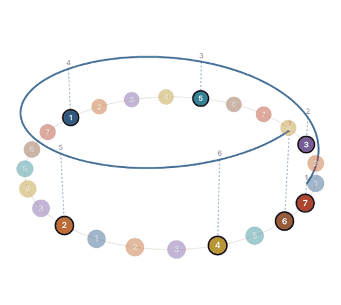

# The shortest rosary on seven symbols

The Lean badge covers the upper bound only; the lower bound is not formalized.

**Answer: 24 beads.** The shortest circle of beads from which every ordering of seven symbols can be read, going once clockwise and skipping beads freely, has 24 beads. In the notation of [OEIS A373728](https://oeis.org/A373728), $r(7)=24$.

[Paper (PDF)](paper/manuscript.pdf) ·
[TeX source](paper/manuscript.tex) ·
[Problem and proof](proof/PROBLEM_AND_PROOF.md) ·
[Mathematical audit](audits/public_safe_reports/MATHEMATICAL_AUDIT.md) ·
[Literature and priority audit](audits/public_safe_reports/LITERATURE_PRIORITY_AUDIT_2026-11-25.md) ·
[Scope and limitations](CLAIM_SCOPE_AND_LIMITATIONS.md) ·
[Reproduce](REPRODUCIBILITY.md) ·
[3D explorer](visualization/README.md) ·
[Citation](CITATION.cff)

## The problem

A *rosary of degree n* is a cyclic word over $\{1,\dots,n\}$ such that every permutation of $\{1,\dots,n\}$ is a subsequence of some rotation of the word: choose a starting bead, move once around the circle, and pick out the permutation's letters in order without passing the start again. Let $r(n)$ be the least length of such a word.

Hansraj Gupta conjectured in 1981 that $r(n)=\lfloor n^2/2\rfloor$ ([Gupta 1981](https://doi.org/10.1007/BFb0092270), p. 273). The exact form fails for $n=6$ and $n=8$ ([Lecouturier–Zmiaikou 2012](https://doi.org/10.1016/j.disc.2011.12.027) give 17 and 31 beads), and the upper-bound form $r(n)\le n^2/2$, Guy's problem E22, is proved only for even $n$. OEIS A373728 lists $r(2),\dots,r(6)=2,4,8,12,17$. For $n=7$ the best published bound was $r(7)\le 25$.

## The result

**Theorem.** $r(7)=24$. In particular Gupta's value $\lfloor n^2/2\rfloor$ is correct for $n=7$.

- **Upper bound.** `123456712347654321765432` is a rosary: the Lecouturier–Zmiaikou word for $n=7$ with one bead `5` removed. This 24-bead rosary was posted earlier by Adam Ever-Hadani ([log dated 29 August 2026](https://github.com/adamhadani/superpatterns/blob/main/experiments/w4-alphabet-rosary/log.md)); it is not new here.
- **Lower bound (the new part).** No rosary of degree 7 has 23 beads, so none is shorter. The proof reduces the question to a finite search. Deleting every copy of one symbol from a rosary leaves a rosary, so a 23-bead rosary can be grown one symbol at a time, least frequent first. Adding a new symbol $x$ is a hitting-set problem: for each ordering $P$ of the old symbols, let $G(P)$ be the gaps from which $P$ can be read in one lap; the larger circle works exactly when the beads $x$ occupy a gap of every $G(P)$, because every ordering of the larger alphabet is a rotation of "$x$, then $P$". An exhaustive search over all 164 ways to split 23 beads among seven symbols, with symmetry reduction, finds no rosary.
- **By-product.** The same search shows that no rosary of degree 6 has 16 beads, so $r(6)=17$. We found no earlier published proof of $r(6)\ge 17$.

The lower bound is a computer-assisted proof: the reduction is proved by hand in the paper, and the search is load-bearing.

## Explore the proof in 3D

The [interactive explorer](visualization/README.md) shows the 24-bead circle. Pick any ordering of 1–7 and watch the reading path climb once around the circle; remove a bead and see which orderings fail. A second scene shows the insertion step: the three beads `7` must touch a "readable gap" for every one of the 720 orderings of 1–6.

Download [`visualization/seven-symbol-rosary-explorer.zip`](visualization/seven-symbol-rosary-explorer.zip), unzip it, and open the HTML file in a browser. It runs offline and uses no external libraries.

## Verification status

| Gate | Status |
|---|---|
| Upper bound | Direct check of all 5040 permutations; every one-bead deletion fails |
| Lower bound | Four separately written search programs agree that no 23-bead rosary exists; two use a different reduction order and symmetry handling from the original |
| Small-case calibration | Brute force over all words for $n\le5$ (up to $5^{13}$ words) and SAT for $n=6$, $L=16$ agree with the search |
| Mathematical audit | Three independent AI audits (hostile, reconstruction, code and scope): all pass, no invalid step found |
| Literature and priority | Three search lanes through 2026-11-25. The lower bound appears to be new after a documented search; the 24-bead upper bound was posted earlier and is credited |
| Formal verification | Partial: the upper bound is kernel checked in Lean 4 ([`formalization/`](formalization/README.md)). The lower bound is not formalized |
| Peer review | Not peer reviewed |

## Citation

See [`CITATION.cff`](CITATION.cff). A DOI will be added after release.

## Authorship and AI disclosure

The repository author identity is `DannyExperiments`. AI systems found the proof, wrote and audited the search programs, ran the literature review and prepared the manuscript; no AI system is listed as an author. See [`AI_DISCLOSURE.md`](AI_DISCLOSURE.md) and [`PROVENANCE.md`](PROVENANCE.md).
